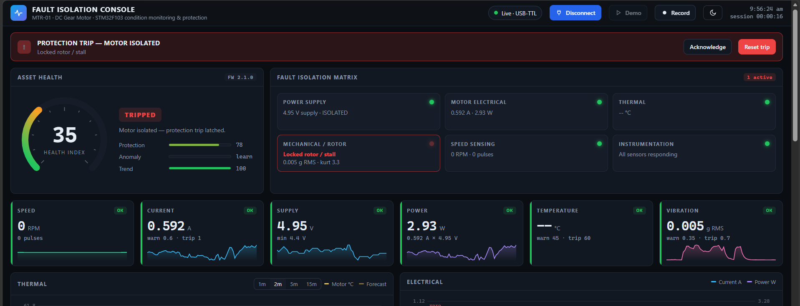

# Industrial Fault Isolation System

Condition monitoring and automatic protection for a small DC motor, built on an STM32 board with low-cost sensor modules.

The controller reads the motor's **current, vibration, speed and supply voltage**, works out what kind of fault is happening, and **cuts power to the motor through a relay** when a critical fault persists. A browser dashboard shows the live data, the isolated fault and its trend.



## What it does

- **Measures** current (ACS712), 3-axis vibration at 1 kHz (MPU6050), shaft speed (TCRT5000) and the 5 V supply (resistor divider).
- **Computes** vibration RMS, peak, crest factor, kurtosis and dominant frequency (256-point FFT) on the microcontroller.
- **Protects**: overcurrent, locked rotor (stall) and high vibration open the relay after a short persistence time, so start-up current and single bumps don't cause false stops. The trip latches until it is reset.
- **Isolates the cause**: for example, "0 RPM with high current and no vibration" is a stall, while "0 RPM with normal current and vibration" is a faulty speed sensor, so it only warns.
- **Fail-safe**: the motor runs only while the relay is energised. Power loss, reset or a firmware hang (4 s watchdog) all stop it.
- **Shows** status on a 16×2 LCD and on a PC dashboard (Chrome or Edge, no install), with CSV recording, a threshold editor and a demo mode.

## Repository layout

```
firmware/FaultIsolation/FaultIsolation.ino   main firmware (Arduino IDE + STM32duino core)
firmware/RelayTest/RelayTest.ino             tiny sketch to check the relay module on its own
dashboard/FaultIsolation_Dashboard.html      PC dashboard, open in Chrome or Edge
dashboard/start_dashboard.bat                fallback: serves the dashboard on localhost
docs/WIRING.md                               every connection, pin by pin
docs/FLASHING.md                             Arduino IDE setup and three ways to upload
docs/HOW_IT_WORKS.md                         protocols, ADC, signal processing, protection logic
docs/TROUBLESHOOTING.md                      problems we hit and how we fixed them
```

## Bill of materials

| Qty | Part | Notes |
|---|---|---|
| 1 | STM32F411CEU6 "Black Pill" | Tested build. An STM32F103C8T6 "Blue Pill" also works (LCD SDA moves to PB11). |
| 1 | MPU6050 module (GY-521) | Vibration sensor, powered from 3.3 V |
| 1 | ACS712 current sensor module | 30 A version used (66 mV/A); the 5 A version (185 mV/A) gives better resolution |
| 1 | TCRT5000 IR sensor module | With LM393 comparator and DO pin |
| 1 | 1-channel 5 V relay module (SRD-05VDC-SL-C) | Active-low input |
| 1 | 16×2 LCD with PCF8574 I²C backpack | Address 0x27 or 0x3F, both detected automatically |
| 1 | USB-TTL adapter (CH340 / CP2102) | PC link and firmware upload |
| 1 | HW-131 / MB102 breadboard power module | Supplies the 3.3 V and 5 V rails (see the warning in WIRING.md) |
| 1 | Small DC gear motor | Any 6–12 V brushed motor |
| 1 | 9 V battery + clip | Separate motor supply |
| 3 | 10 kΩ resistors | Two for the supply divider, one in series with the ACS712 output |
| 1–3 | 100 nF–0.47 µF ceramic capacitors | Across the motor terminals (noise suppression) |
| – | Perfboard, female headers, jumper wires | |
| 1 | ST-Link V2 (optional) | Only if you prefer SWD uploads |

Optional: LM35 temperature sensor on PA4 (disabled in the tested build, see `TEMP_FITTED`), and three LEDs with 330 Ω resistors on PB13/PB14/PB15.

## Quick start

1. **Wire it** following [docs/WIRING.md](docs/WIRING.md). Measure both supply rails before connecting the controller.
2. **Install** the Arduino IDE and the STM32duino core, then **upload** the firmware: [docs/FLASHING.md](docs/FLASHING.md).
3. **Open** `dashboard/FaultIsolation_Dashboard.html` in Chrome or Edge, click **Connect**, and pick the USB-TTL's COM port at 115200 baud.
4. **Press reset.** The board zeroes the current sensor with the relay open, then switches the relay on and starts the motor.
5. **Test**: tap the motor (vibration rises), hold the shaft (stall trip), click **Emergency isolate** (manual stop), then **Reset trip**.

No dashboard? Use any serial terminal at 115200 baud: you'll see one JSON line every 250 ms and can type the commands below.

## Serial commands

| Command | Effect |
|---|---|
| `PING` | Replies `{"ack":"PING","ok":1}` |
| `GET` | Prints the current configuration |
| `STOP` | Manual trip: opens the relay |
| `RESET` | Clears a trip and restarts the motor |
| `ZERO` | Opens the relay briefly and re-measures the current-sensor zero |
| `SET <key> <value>` | Changes a setting (see table) |
| `SAVE` | Stores the settings in flash |
| `DEFAULTS` | Restores the defaults (then `SAVE` to keep them) |

| Key | Meaning | Default |
|---|---|---|
| `iw` / `ic` | Current warning / trip (A) | 0.60 / 1.00 |
| `vw` / `vc` | Vibration warning / trip (g RMS) | 0.35 / 0.70 |
| `stall` | Minimum current for a stall (A) | 0.40 |
| `uv` | Under-voltage warning (V) | 4.40 |
| `tw` / `tc` | Temperature warning / trip (°C), only with the LM35 fitted | 45 / 60 |
| `sens` | Current-sensor sensitivity (V/A): 0.185 (5 A), 0.100 (20 A), 0.066 (30 A) | 0.066 |
| `ppr` | Pulses per shaft revolution (reflective marks) | 1 |
| `autotrip` | 1 = trip the relay on critical faults, 0 = report only | 1 |
| `vref` | ADC reference voltage | 3.30 |

Tune `stall` to your motor: set it between the current when running freely and the current with the shaft held. A 9 V PP3 battery often can't supply 0.4 A, so a lower value such as 0.2 may be needed.

## Telemetry format

One JSON object per line:

```
{"d":{"t":12345,"n":49,"rpm":3238.0,"i":0.164,"v":5.03,"p":0.82,"tc":null,"vr":0.0058,"vp":0.019,"cf":3.26,"ku":3.13,"vf":91.3,"va":0.0016,"ax":0.0040,"ay":0.0028,"az":0.0042,"h":100.0,"s":0,"f":0,"tr":0,"tf":0,"ok":15,"pc":0,"acs":2.557}}
```

`rpm` speed · `i` current (A) · `v` supply (V) · `p` power (W) · `tc` temperature · `vr` vibration RMS (g) · `vp` peak · `cf` crest factor · `ku` kurtosis · `vf` dominant frequency (Hz) · `h` health index · `s` status (0 normal, 1 warning, 2 alarm, 3 tripped) · `f` fault bits · `tr` tripped · `pc` total speed pulses · `acs` raw current-sensor voltage.

Fault bits: 0 temp warn · 1 temp crit · 2 current warn · 3 current crit · 4 stall · 5 vibration warn · 6 vibration crit · 7 under-voltage · 8 no load / open circuit · 9 impacts · 10 temperature sensor · 11 IMU · 12 current sensor · 13 speed sensor · 14 no supply · 15 manual stop.

## Known limitations

- **Motor noise vs. I²C:** on our build, brush noise from the running motor disrupted the MPU6050's I²C link, so vibration dropped out while the motor ran. The firmware detects this and reconnects automatically. Twisted SDA/SCL wires with ground, a capacitor across the motor terminals, and keeping the motor wiring away from the logic help; shielded cable or an SPI accelerometer would fix it properly.
- **Current resolution:** the 30 A ACS712 gives about 12 mA per ADC step. The 5 A version is a better fit for small motors.
- **Temperature:** the LM35 was unreliable in our build and is disabled; a DS18B20 is the planned replacement.

See [docs/TROUBLESHOOTING.md](docs/TROUBLESHOOTING.md) for everything we ran into.

## Team

Prabhu Sivakumar, Thiruchelvan, Haree Haran TJ. Guide: Dr. Vydeki D.
B.Tech ECE, VIT Chennai. Course BAECE204, Microcontrollers and Embedded C Programming.

## License

MIT. See [LICENSE](LICENSE).
